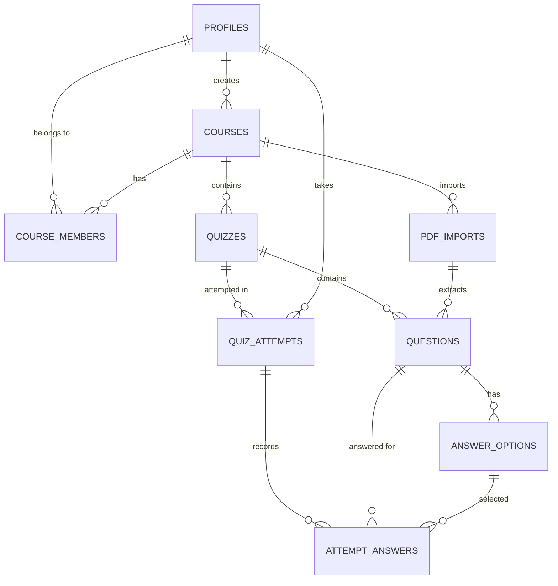

# Database Design Specification — Stage 2

This document details the database schema, data models, entity relationships, and integrity constraints for the academic quiz platform.

---

## 1. Entity-Relationship Overview

---

## 2. Table Specifications

### 2.1 `profiles`
Stores user profile information synced with `auth.users`.
- `id` (uuid, PK): Foreign key to `auth.users(id) ON DELETE CASCADE`.
- `email` (text): User email address.
- `display_name` (text): Public name shown on leaderboards and course lists.
- `role` (text): Constrained to `'admin'`, `'lecturer'`, `'student'`. Defaults to `'student'`.
- `avatar_url` (text): Optional avatar image URL.
- `created_at` / `updated_at` (timestamptz).

### 2.2 `courses`
Academic courses managed by staff.
- `id` (uuid, PK): Unique course ID.
- `course_code` (text, UNIQUE): e.g., `CS101`, `MATH202`.
- `name` (text): Course title.
- `description` (text): Course overview.
- `created_by` (uuid, FK -> `profiles.id`): Initial instructor or admin.
- `created_at` / `updated_at` (timestamptz).

### 2.3 `course_members`
Association table linking lecturers and students to courses.
- `id` (uuid, PK).
- `course_id` (uuid, FK -> `courses.id` ON DELETE CASCADE).
- `user_id` (uuid, FK -> `profiles.id` ON DELETE CASCADE).
- `membership_role` (text): `'lecturer'`, `'student'`, or `'assistant'`.
- `created_at` (timestamptz).
- Constraint: `UNIQUE(course_id, user_id)`.

### 2.4 `pdf_imports`
Tracks uploaded question paper PDFs and parsing status.
- `id` (uuid, PK).
- `course_id` (uuid, FK -> `courses.id` ON DELETE CASCADE).
- `uploaded_by` (uuid, FK -> `profiles.id` ON DELETE RESTRICT).
- `storage_path` (text): Path in private Supabase Storage bucket.
- `original_filename` (text).
- `status` (text): `'uploaded'`, `'processing'`, `'needs_review'`, `'ready_to_publish'`, `'published'`, `'failed'`.
- `error_message` (text): Debugging info if extraction fails.
- `extracted_data` (jsonb): Structured raw extraction payload.
- `created_at` / `processed_at` (timestamptz).

### 2.5 `quizzes`
Published or draft quizzes.
- `id` (uuid, PK).
- `course_id` (uuid, FK -> `courses.id` ON DELETE CASCADE).
- `title` (text).
- `description` (text).
- `status` (text): `'draft'`, `'published'`, `'archived'`.
- `duration_minutes` (integer): Time limit.
- `starts_at` / `ends_at` (timestamptz): Availability window.
- `max_attempts` (integer): Max attempts permitted per student.
- `passing_score` (numeric(5,2)): Threshold score.
- `allow_review` (boolean): Whether students can review answers after completion.
- `shuffle_questions` (boolean).
- `created_by` (uuid, FK -> `profiles.id`).

### 2.6 `questions`
Questions belonging to quizzes.
- `id` (uuid, PK).
- `quiz_id` (uuid, FK -> `quizzes.id` ON DELETE CASCADE).
- `pdf_import_id` (uuid, FK -> `pdf_imports.id` ON DELETE SET NULL).
- `question_text` (text).
- `question_type` (text): `'multiple_choice'`, `'true_false'`, `'short_answer'`.
- `marks` (numeric(5,2)): Mark value (default 1.0).
- `position` (integer): Order in quiz.
- `verification_status` (text): `'unverified'`, `'verified'`, `'flagged'`.

### 2.7 `answer_options`
Options for multiple-choice questions.
- `id` (uuid, PK).
- `question_id` (uuid, FK -> `questions.id` ON DELETE CASCADE).
- `option_label` (text): 'A', 'B', 'C', 'D'.
- `option_text` (text).
- `is_correct` (boolean): Correct answer indicator.
- `position` (integer).

### 2.8 `quiz_attempts`
Student quiz attempts and calculated scores.
- `id` (uuid, PK).
- `quiz_id` (uuid, FK -> `quizzes.id` ON DELETE CASCADE).
- `student_id` (uuid, FK -> `profiles.id` ON DELETE CASCADE).
- `attempt_number` (integer): Attempt count for this student.
- `status` (text): `'in_progress'`, `'submitted'`, `'abandoned'`, `'timed_out'`.
- `started_at` / `submitted_at` (timestamptz).
- `score` (numeric(6,2)): Total earned marks.
- `total_marks` (numeric(6,2)): Total possible marks.
- `percentage` (numeric(5,2)).
- Constraint: `UNIQUE(quiz_id, student_id, attempt_number)`.

### 2.9 `attempt_answers`
Individual answers recorded during an attempt.
- `id` (uuid, PK).
- `attempt_id` (uuid, FK -> `quiz_attempts.id` ON DELETE CASCADE).
- `question_id` (uuid, FK -> `questions.id` ON DELETE CASCADE).
- `selected_option_id` (uuid, FK -> `answer_options.id` ON DELETE SET NULL).
- `answer_text` (text): For future short answer types.
- `is_correct` (boolean): Calculated on submission.
- `marks_awarded` (numeric(5,2)): Calculated on submission.
- Constraint: `UNIQUE(attempt_id, question_id)`.
